# 검증 기록

2026-10-29, Minecraft 26.2 / Fabric Loader 0.19.5 / Fabric API 0.160.0+26.2 / Java 25 / Windows / OpenGL에서 검증했습니다.

## 0.1.4 표시 설정과 플래그 전체 제거

- `gradlew.bat --offline build compileGametestJava` 통과. 모델 검증 **123개 항목 통과**.
- Show Interaction 0.2.1과 함께 로딩한 실제 게임 통합 검사 통과.
- 기본 16색 RGB는 유지하고, 설정/툴팁은 색상 이름만 표시하도록 변경.
- 모든 차원의 플래그 제거, 확인 취소 시 유지, 확인 후 실제 블록 불변, 타임라인·최종 태그·상대 틱·표시 설정 보존 확인.
- 전체 제거 후 설치 모드 종료, 버튼 비활성화, 렌더링 표시 제거, 새 플래그 설치 재개 확인.
- 표시 설정에서 윤곽선 두께, 플래그 크기, X/Y/Z 위치, 이름 표시, 가려진 윤곽선, 투명도와 표시 방식 조절.
- 실제 슬라이더 키 입력으로 값 변경, 저장 전 원본 유지, 창 크기 변경 후 작성 중 값 유지, 저장/취소/기본값 복원 확인.
- 위치·크기 변경 후 렌더링 좌표와 클릭 영역이 일치하고, 실제 우클릭으로 설정이 열림을 확인. 감시 대상 좌표는 그대로 유지.
- 표시 설정 저장/복원, 범위 밖·유효하지 않은 숫자의 안전한 정리, 0.1.3 파일의 기본 표시값 호환 확인.
- 854×480과 1000×700의 설정 및 확인창을 실제 스크린샷으로 확인.

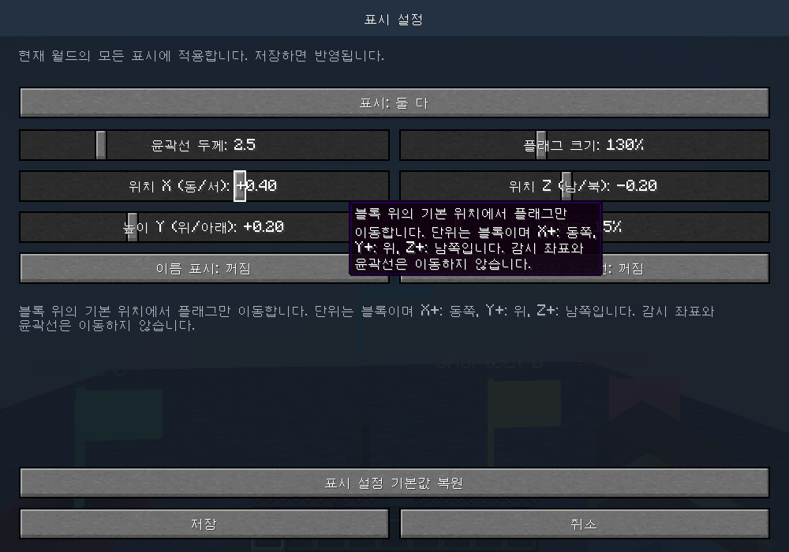

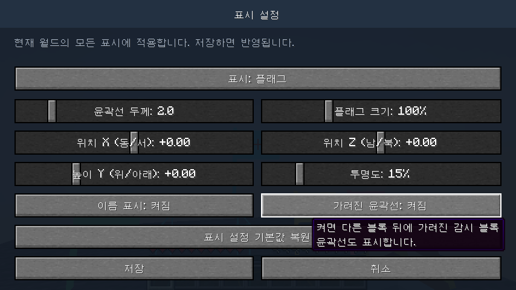

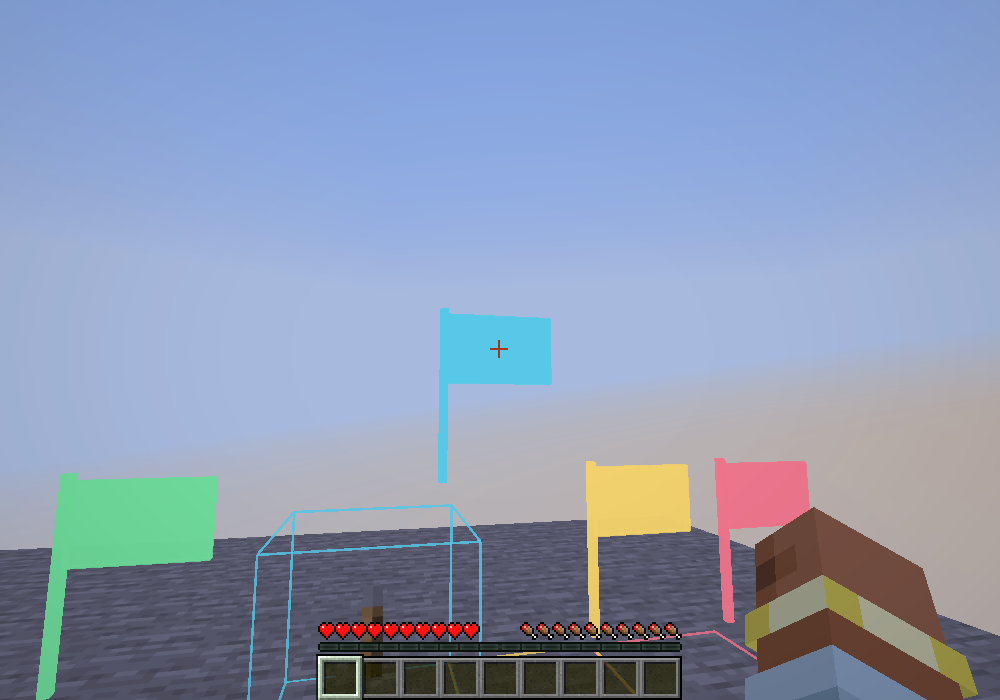

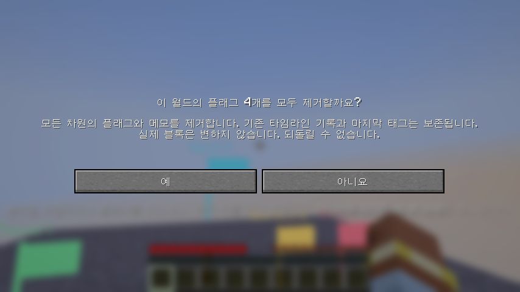

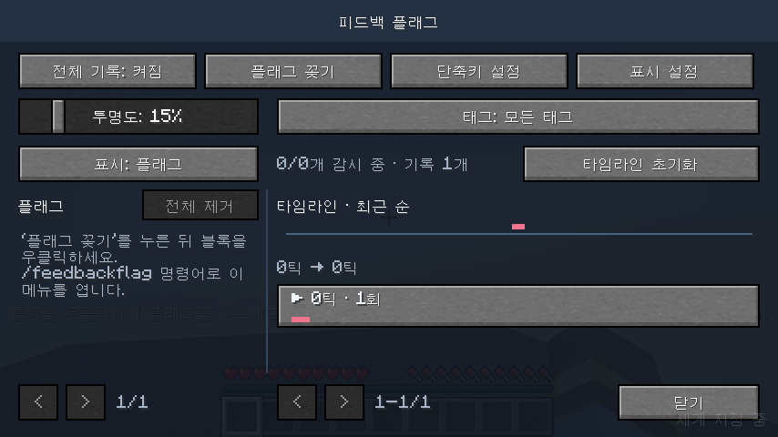

## 0.1.3 상대 틱·태그·묶음·표시 방식

- `gradlew.bat --offline build compileGametestJava` 통과. 모델 검증 **107개 항목 통과**.
- Show Interaction 0.2.1과 함께 로딩한 실제 게임 통합 검사 통과.
- 첫 변화 0틱, 같은 틱의 다른 플래그 0틱, 이후 정확한 틱 차이 확인. 필터·재접속·자동 기록 제거에도 원점 유지.
- 전체 초기화 후 새 0틱, 개별 초기화 시 공통 기준 유지, 이전 저장 자료의 원점·태그·표시 방식 기본값 변환 확인.
- 서버 `tick freeze` 중 실제 플래그 3개에서 발생한 변화 4건을 한 그룹으로 표시. '외 2개', 고유 플래그별 색상 3개, 펼친 개별 변화 4행 확인.
- 묶음 펼치기/접기와 상세 열기, 작은 창에서 펼친 목록 스크롤, 최신 변경 시 그룹 식별 유지.
- 한국어 태그 입력, 8개/24자 제한, 중복·대소문자 정리, 이름·메모와 독립 저장, 태그 변경의 기존 이력 적용, 삭제된 플래그의 마지막 태그 보관 확인.
- 전체/사용자 태그/태그 없음 필터와 플래그 필터 교집합, 필터 후 상대 틱 기준 유지 검증.
- 플래그 → 블록 윤곽선 → 둘 다 UI 전환 및 렌더링 확인. 블록만 표시할 때 숨은 플래그가 클릭을 가로채지 않음, 전체 투명도 적용 확인.
- 기본 16색 선택과 검은색 클릭 결과 확인. 기본 16색의 RGB를 사용하며 게임 이미지는 재배포하지 않습니다.
- 854×480 및 1000×700의 세부 설정, 태그, 접힌/펼친 타임라인과 월드 표시를 실제 스크린샷으로 확인.

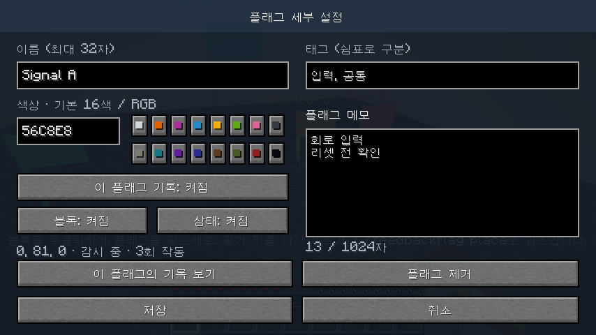

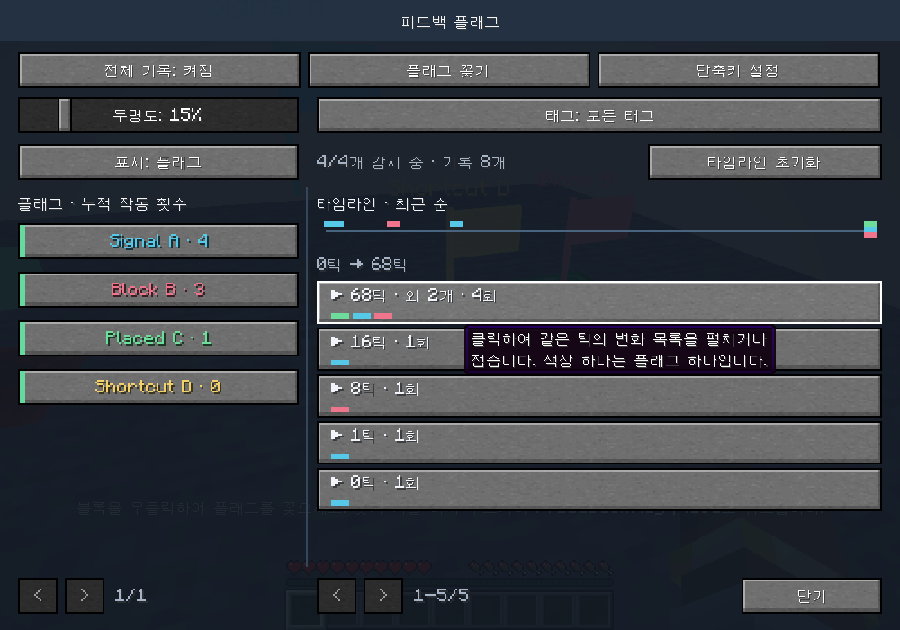

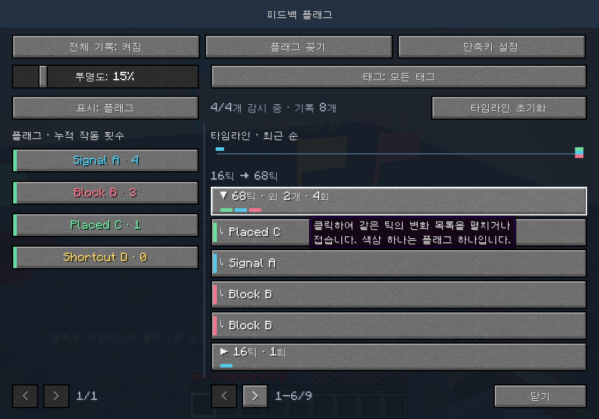

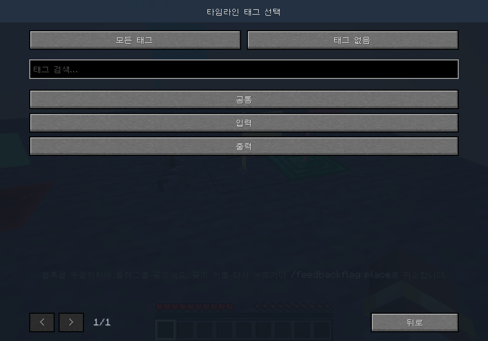

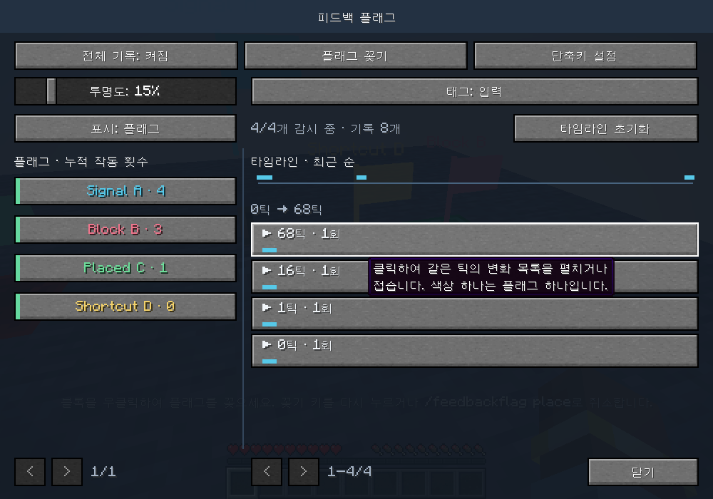

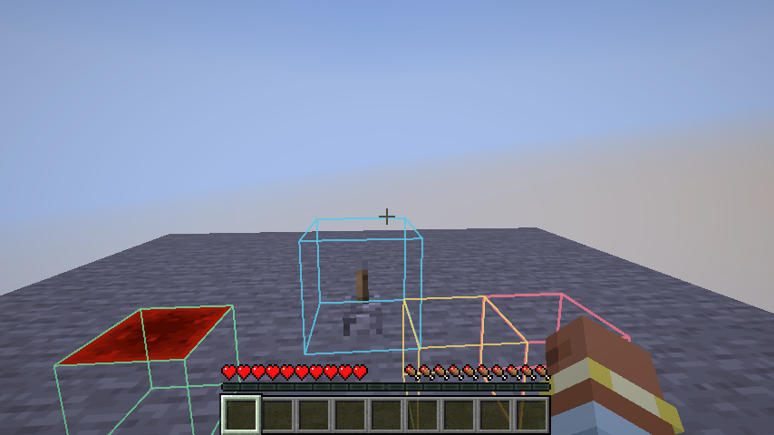

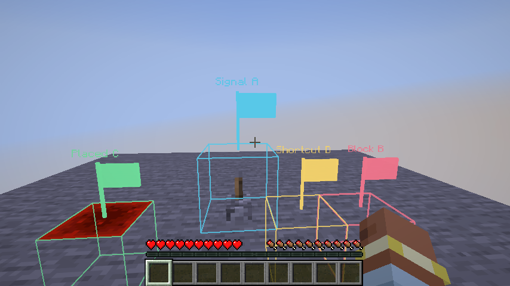

아래는 이전 버전의 검증 이력입니다. 현재 화면은 0.1.3의 상대 틱과 틱별 묶음 방식을 사용합니다.

## 0.1.2 타임라인·단축키·메모 편집 개선

- `gradlew.bat --offline build compileGametestJava` 통과. 모델 검증 **78개 항목 통과**.
- Show Interaction 0.2.1을 함께 로딩한 실제 게임 통합 검사 통과.
- 타임라인의 점 위치, 기록 행과 상세 내용을 월드 게임틱으로 표시. 현실 시각과 무관한 틱 간격 검증.
- 서버의 `tick freeze` 상태에서 여러 클라이언트 틱이 지나도 블록 변화가 동일한 월드 게임틱으로 기록됨을 실제 게임에서 확인.
- 구버전 저장 파일의 틱 기준 보존, 저장 후 재로딩, 과거 틱/월드 시간 역행 시 수신 순서 표시 검증.
- 전체·개별 초기화, 확인 취소, 작동 횟수 초기화, 메모·설정·관찰 기준 유지, 파일 저장 및 다음 변화부터 기록 재개 확인.
- 메뉴 열기와 플래그 꽂기 키 모두 기본 미지정. F8/F9 별도 지정, Escape로 해당 키 해제, 다른 키 유지 확인.
- F9로 설치 모드 켜기/취소, 블록 우클릭으로 한 번 설치 후 종료, 화면을 연 동안 단축키가 작동하지 않음 확인.
- 세부 설정 안의 메모 입력칸에서 한글·Enter 입력, 저장·취소, 길이 제한과 창 크기 변경 후 작성 중 내용 유지 확인.
- 854×480과 1000×700 화면을 확인. 배포 JAR에는 게임 테스트 코드가 포함되지 않음.

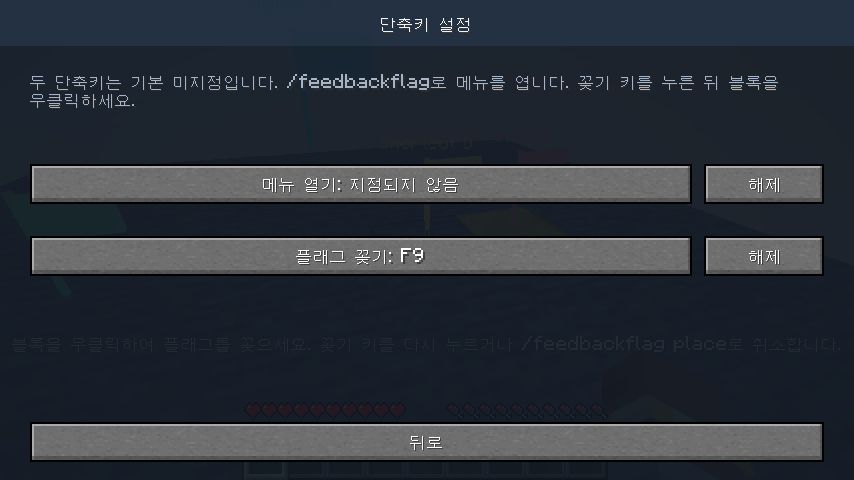

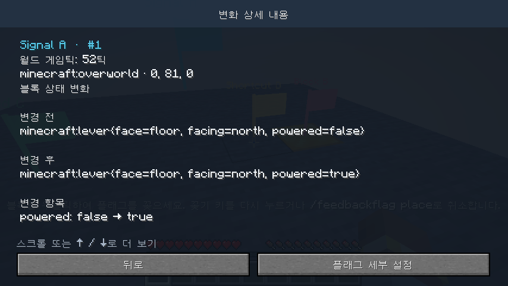

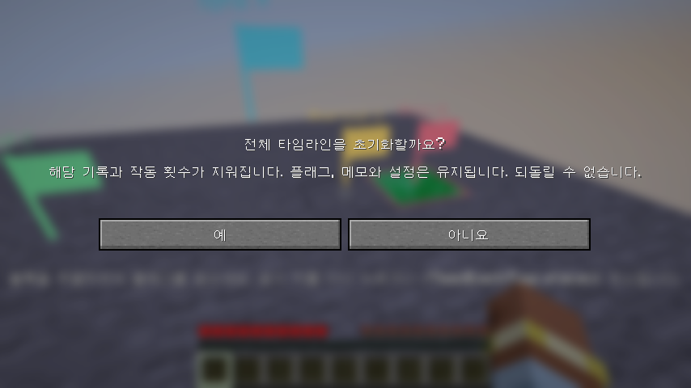

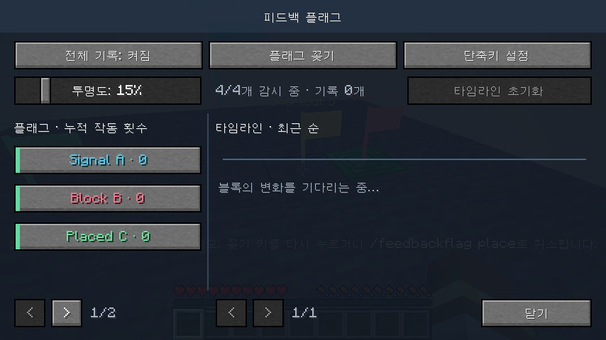

아래는 이전 버전에서 수행한 검증 이력입니다. 0.1.2에서는 별도 메모 창이 제거되고 세부 설정 안에서 직접 편집합니다.

## 0.1.1 메모 기능 검증

- 이름과 별도로 저장되는 플래그별 여러 줄 메모, 최대 1,024자.
- 0.1.0의 메모 없는 저장 파일과 `memo: null`을 빈 메모로 읽고 기존 이름·이력 보존.
- 다른 플래그와의 메모 분리, 이름·활성화 변경 및 서버 상태 갱신 후 유지.
- 한글·이모지·빈 줄·줄바꿈 저장/복원, 메모 지우기, 글자 수 제한 검증.
- 모델 검증 **57개 항목 통과**.
- 실제 게임에서 한글 입력과 Enter 줄바꿈, 창 크기 변경, 적용 후 재진입, 글자 수 초과 시 적용 차단 확인.
- 메모 창 취소/Escape와 플래그 설정 취소의 변경 취소 범위를 실제 게임에서 확인.
- 한국어 메모 편집 화면과 변화 상세 화면의 현재 메모 표시 확인.
- Show Interaction 0.2.1을 함께 설치한 상태에서 게임 통합 테스트 통과.

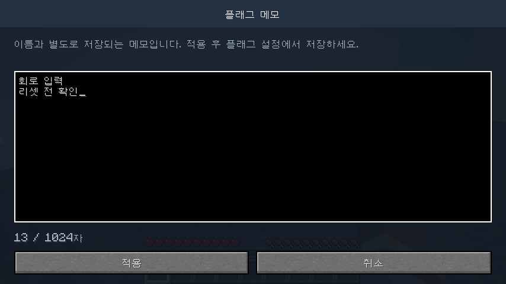

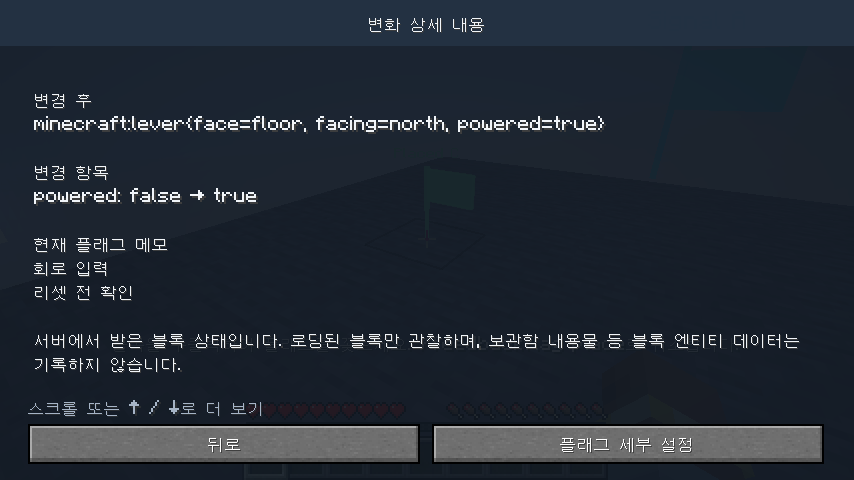

## 0.1.0 기본 자동 검증

`gradlew.bat --offline build runClientGameTest` 통과.

모델 테스트는 다음 범주의 44개 검증 항목을 포함합니다.

- 변화 전후 값, 블록 종류/상태 분류, 동일 상태 중복 제거, 같은 틱의 연속 이벤트
- 전체/개별 정지 및 재개, 필터에서 제외한 상태의 기준 갱신
- 청크 언로드와 월드 재진입 시 관찰 기준 초기화, 차원별 분리
- 128개 플래그/5,000개 기록 상한, 오래된 기록 제거 후 누적 횟수 보존
- 글자 제한과 한글/유니코드, 플래그 제거 후 과거 메타데이터 보존
- 파일 저장/복원, 설정 유지, 이벤트 순번 복원, 깨진 파일과 저장 실패 처리

게임 통합 테스트는 별도 싱글 월드에서 실제 서버와 클라이언트를 실행합니다.

- `/feedbackflag add`로 추가, 글자와 색상 변경 및 저장
- 레버 `powered=false → true → false` 패킷과 블록 교체 패킷 기록
- 타임라인 기록 행 클릭으로 상세 화면 열기
- 일반 레버 우클릭 동작 유지, 플래그 자체 우클릭으로 설정 열기
- 기본 단축키 미지정, F8 지정 후 메뉴 열기, 다시 미지정으로 해제
- 전체 기록 정지 중 변화 제외
- `/ff`로 메뉴 열기, 설치 모드에서 우클릭으로 추가, 한 번 설치 후 모드 종료
- 실제 파일 저장, 한국어 전환, 854×480 및 1000×700 화면 출력

게임이 출력한 스크린샷을 확인해 작은 창에서의 화면 배치와 플래그 글자 가독성을 검증했습니다. 게임 테스트 모드와 클래스는 배포 JAR에 포함되지 않습니다.

## 확인 범위

독립된 멀티플레이 서버, Show Interaction 이외의 모드 조합, Vulkan 렌더러는 이번 검증에 포함되지 않았습니다. 기록은 클라이언트가 받은 블록 상태 변경을 대상으로 하며 서버 전체 변경 이력이나 블록 엔티티 내용물을 보장하지 않습니다.

## 화면

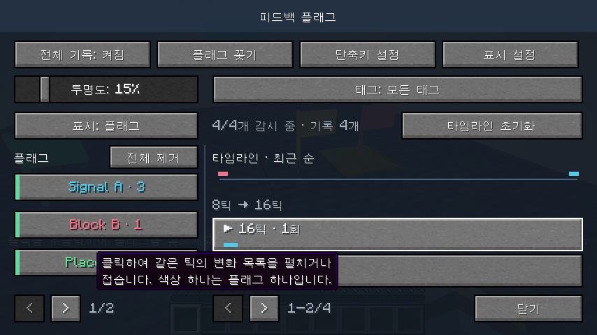

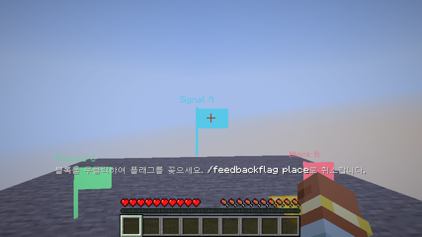
